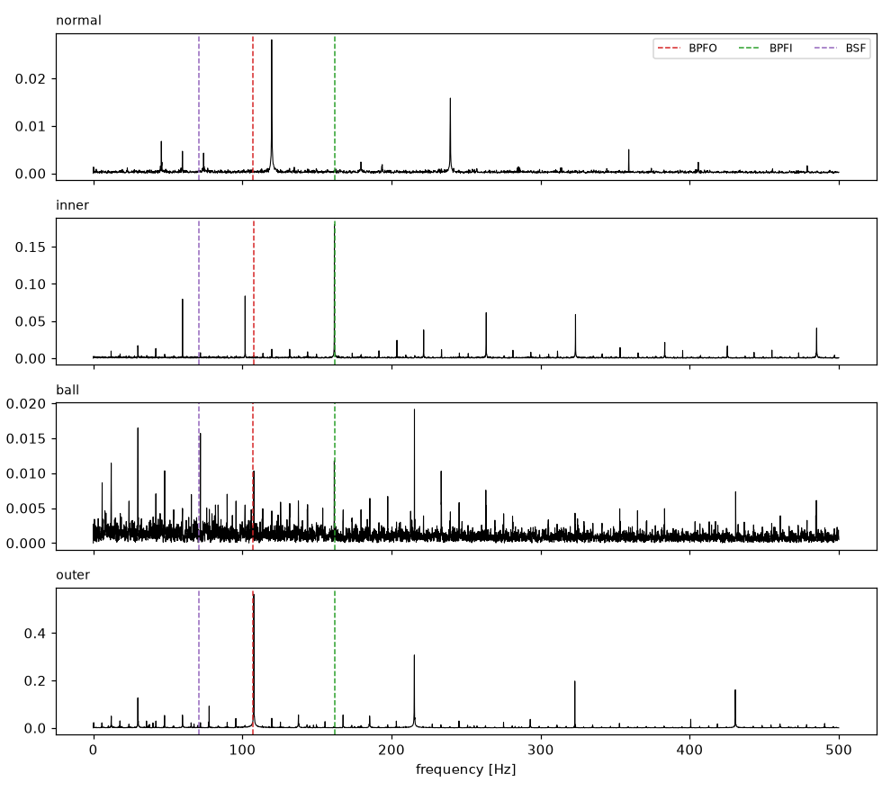

# Bearing Pulse

**End-to-end vibration fault detection — from a public dataset to my own sensor node, edge ML and custom PCB.**

A small, at-home version of an industrial predictive maintenance system (the kind used to monitor wind turbines and other rotating machines). Every phase is documented as a step-by-step build log, including what went wrong.

> 🚧 Work in progress. Phase 1 is done; hardware phases are published as they are finished.

---

## Why

Rotating machines fail slowly: bearings wear, rotors go out of balance. Vibration shows this long before a breakdown. This project walks the full chain an industrial monitoring system needs:

**sensor → microcontroller → network → database → dashboard → ML model → alarm**

…and also asks the question most demos skip: **when does the model get it wrong?**

## Phases

| # | Phase | What it covers | Status |
|---|-------|----------------|--------|
| 1 | [ML on CWRU bearing data](docs/01-ml-on-cwru-data.md) | FFT, envelope spectrum, features, Random Forest, failure under load change | ✅ Done |
| 2 | [Sensor node + MQTT](docs/02-sensor-node-mqtt.md) | ESP32 + ADXL345, MQTT, InfluxDB, Grafana live dashboard | ⬜ Planned |
| 3 | [Edge features](docs/03-edge-features.md) | RMS / kurtosis / FFT bands computed on the ESP32, own labeled dataset | ⬜ Planned |
| 4 | [TinyML on ESP32](docs/04-tinyml-on-esp32.md) | Model running on the device, alarm in Grafana, robustness test | ⬜ Planned |
| 5 | [Field-ready](docs/05-field-ready.md) | Offline buffering, OTA updates, deep sleep, TLS | ⬜ Planned |
| 6 | [Custom PCB](docs/06-custom-pcb.md) | KiCad board for ESP32 + sensor, ordered and assembled | ⬜ Planned |

Status: ⬜ Planned · 🟨 In progress · ✅ Done

## Repository layout

```
bearing-pulse/
├── README.md        ← you are here
├── BOM.md           ← bill of materials, prices, where to buy
├── docs/            ← one build guide per phase
├── src/bearing.py   ← Phase 1 code: loading, fault frequencies, envelope, features
├── notebooks/       ← Phase 1 Jupyter notebooks (use src/bearing.py)
├── firmware/        ← ESP32 code, one folder per phase
├── hardware/        ← wiring diagrams, KiCad files
├── data/            ← dataset download notes (raw data is not committed)
└── images/          ← photos, plots, GIFs used in the docs
```

## Hardware (short version)

ESP32 DevKit · ADXL345 accelerometer · small 12 V fan or DC motor · breadboard and jumpers.
Full list with prices: [BOM.md](BOM.md)

## Quick start (Phase 1)

```bash
git clone https://github.com/aemresrbyk/bearing-pulse.git
cd bearing-pulse
python3.12 -m venv .venv          # 3.10–3.12; newest Python may lack scipy wheels
source .venv/bin/activate        # Windows: .venv\Scripts\activate
pip install -r requirements.txt
python src/bearing.py            # self-check, prints "ok"
jupyter notebook notebooks/
```

Dataset download steps: [data/README.md](data/README.md)

## Results

### Phase 1 — CWRU bearing data ([full write-up](docs/01-ml-on-cwru-data.md))

**How:** drive-end vibration, 12 kHz → 2048-sample windows → features → Random Forest. Train/test split by time inside each recording, so neighbouring windows never leak into the test set.

**Why envelope analysis:** a bearing defect makes a short impact every time a ball passes it. The impacts ring the housing at kHz resonances, so a plain FFT hides the fault frequency. Band-pass (2–5 kHz) → Hilbert envelope → FFT recovers the impact rate, which matches the frequency computed from bearing geometry:



| Test | All 17 features | Envelope features only (3) |
|------|-----------------|----------------------------|
| 0 HP, time split | 100 % | 100 % |
| Train 0 HP → test 1 / 2 / 3 HP | 100 / 100 / 100 % | 100 / 100 / 100 % |
| Train 0.007" → test 0.021" defects | 59.3 % | **97.7 %** |
| Leave-one-severity-out, mean of 3 folds | 57.5 % | **75.5 %** |

**What I learned:** with all features the model learned the spectral *fingerprint* of one defect size and fell to 59.3 % on a bigger defect. Keeping only the envelope amplitudes at the bearing fault frequencies (BPFO, BPFI, 2×BSF), which depend on geometry and shaft speed but not on defect size, brought it to 97.7 %. The feature set was chosen by leave-one-severity-out cross-validation, not by the test score.

### Limitations

- **0.014" defects stay hard (~37 % for every feature set).** In these recordings the outer race fault shows no dominant BPFO peak and the ball fault no clear 2×BSF peak; Smith & Randall's CWRU benchmark (2015) also flags several as not clearly diagnosable. No model can learn a signature that isn't in the signal.
- **Ball faults are the weakest class:** a spinning ball only sometimes hits the defect against a race, so its envelope peak is weak.
- **Confidence is the warning sign:** with all features, no wrong prediction on 0.021" had confidence above 0.5 (vs 0.98 in-distribution). Under load change, confidence dropped 0.98 → 0.84 before any error. A deployed system should report confidence and flag low-confidence windows.
- **One rig, seeded faults:** CWRU faults were made by electro-discharge machining on one test rig. Real machines add noise, varying speed and gradual wear, so 100 % here is not a field accuracy.
- **Next steps:** measure the same pipeline on my own sensor data (Phase 2–4), where the "fault" is a real imbalance on a fan.

Two data traps worth knowing: the CWRU **normal recordings are 48 kHz** while the fault recordings are 12 kHz (verified from matching spectral peaks), and **`99.mat` also contains file 98's signal keys**.

## Author

**Ali Emre Sarıbıyık** — Electrical & Electronics Engineer (Yaşar University). Signal processing, applied ML, embedded systems.

## License

Code: [MIT](LICENSE) · Docs and images: [CC BY 4.0](https://creativecommons.org/licenses/by/4.0/)

## Acknowledgements

Bearing data: [Case Western Reserve University Bearing Data Center](https://engineering.case.edu/bearingdatacenter).
