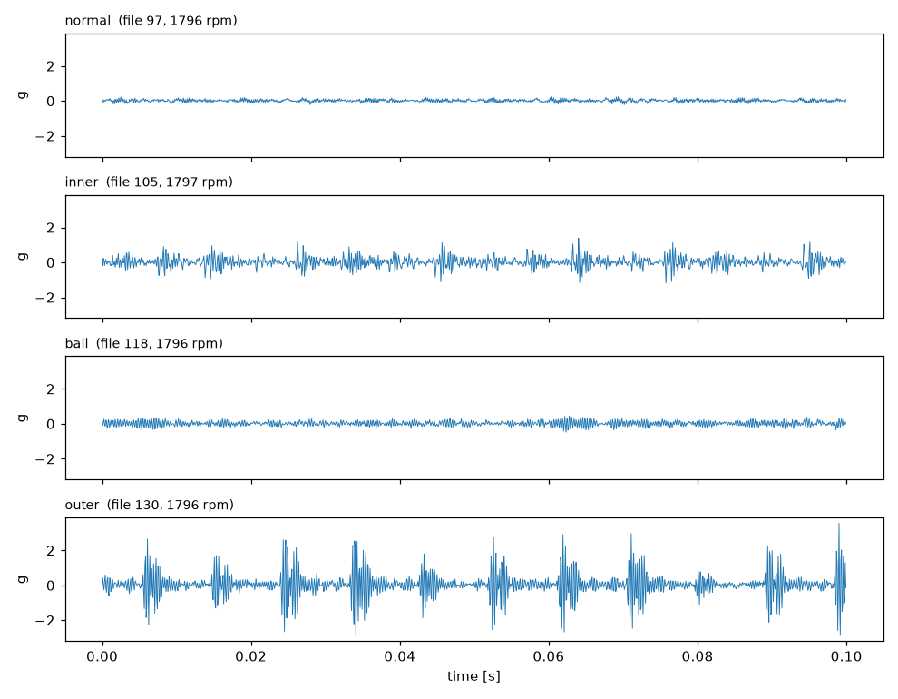
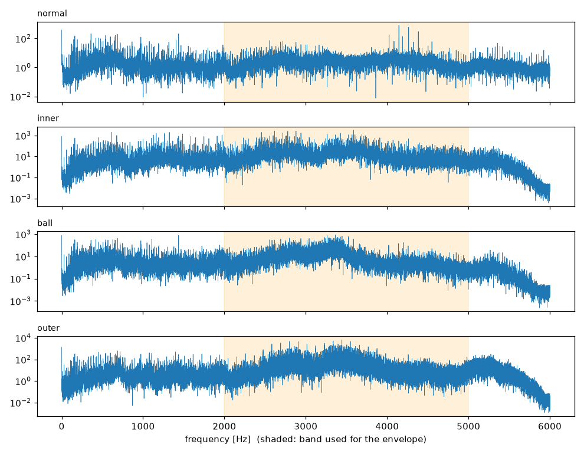
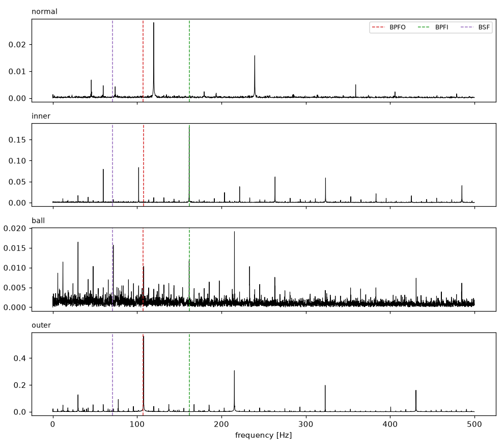
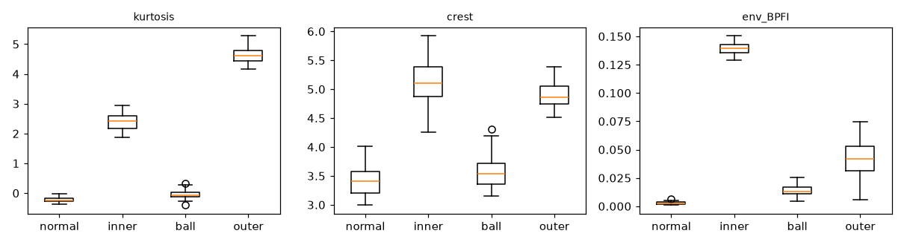
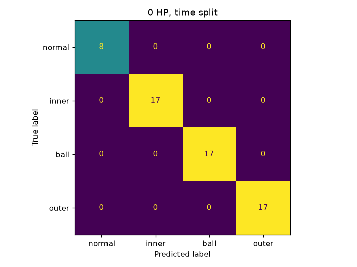
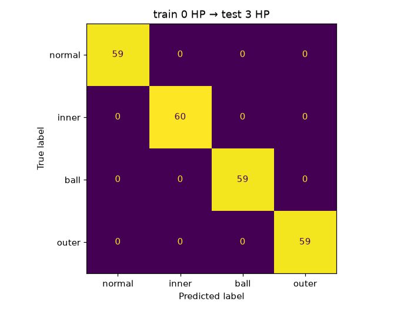
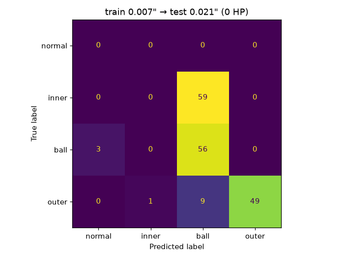
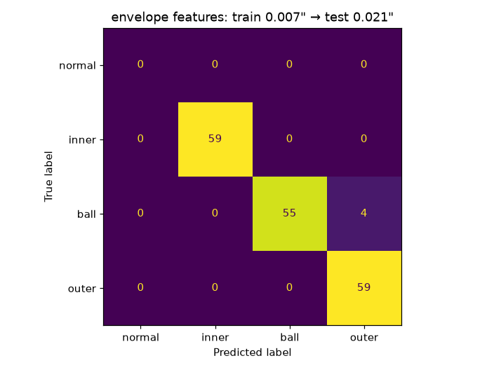
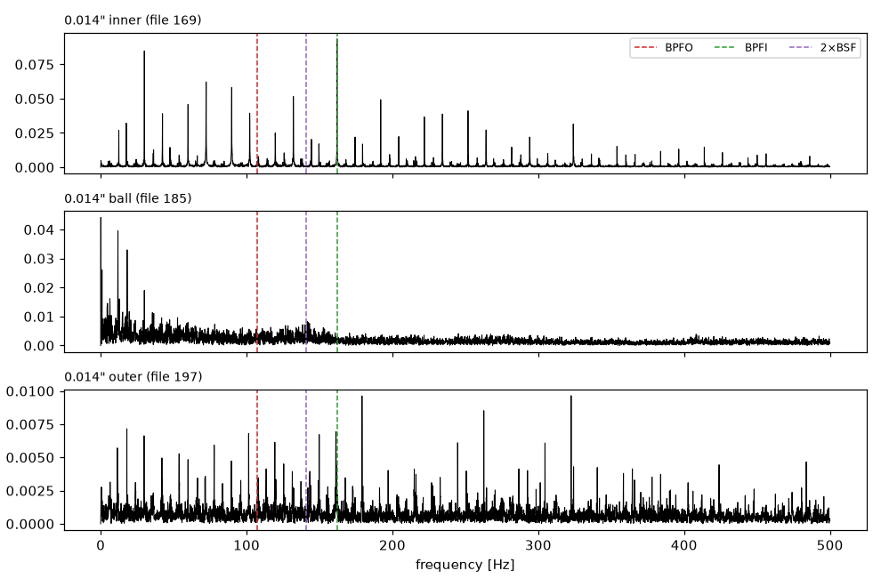

# Phase 1 — ML on CWRU bearing data

**Status:** ✅ Done · **Hardware:** none

## Goal

Classify bearing condition (normal / inner race / outer race / ball fault) from vibration signals, using classic signal processing plus a simple ML model — and then show where the model breaks.

## You need

- Python 3.10–3.12, packages in [`requirements.txt`](../requirements.txt)
- CWRU data files (22 recordings) → see [`data/README.md`](../data/README.md)

All reusable code is in [`src/bearing.py`](../src/bearing.py) (≈130 lines). The notebooks only call it and plot.
Run `python src/bearing.py` for a self-check (fault-frequency formulas and envelope detector).

---

## 0. Setup

```bash
uv venv --python 3.12 .venv      # or: python3.12 -m venv .venv
uv pip install -r requirements.txt
```

**Why Python 3.12 and not the newest:** scientific packages (scipy, scikit-learn) publish binary wheels a few months after a new Python release. 3.12 installs everywhere without compiling.

**Why raw data is not in git:** ~80 MB of `.mat` files that CWRU already hosts. `data/README.md` lists the exact file numbers so anyone can reproduce the dataset.

## 1. The physics: bearing fault frequencies

A rolling-element bearing has an outer race (fixed), an inner race (turns with the shaft), balls, and a cage. A small defect on one of them creates an impact every time a ball rolls over it. How often that happens depends only on geometry and shaft speed:

| Name | Formula | Meaning | at 1797 rpm |
|------|---------|---------|-------------|
| f_r  | rpm / 60 | shaft | 29.9 Hz |
| FTF  | f_r/2 · (1 − d/D) | cage | 11.9 Hz |
| BPFO | n/2 · f_r · (1 − d/D) | ball pass, outer race | 107.4 Hz |
| BPFI | n/2 · f_r · (1 + d/D) | ball pass, inner race | 162.2 Hz |
| BSF  | D/(2d) · f_r · (1 − (d/D)²) | ball spin | 70.6 Hz |

SKF 6205-2RS: n = 9 balls, d = 0.3126", D = 1.537", contact angle 0°.

**How it was checked:** `src/bearing.py` asserts that these formulas reproduce the multiples CWRU publishes (BPFI 5.4152×, BPFO 3.5848×, FTF 0.39828×). CWRU lists the ball frequency as 4.7135× = 2 × BSF, because a spinning ball hits *both* races once per revolution.

## 2. Load and plot

`scipy.io.loadmat` returns a dict; the drive-end accelerometer signal is under `X<num>_DE_time`.

Two traps found while loading:

1. **The normal recordings are sampled at 48 kHz, the fault recordings at 12 kHz.** It's easy to miss because nothing in the file says so. How I verified it: read file 97 as 12 kHz and its spectral peaks do not match any of the fault files; read it as 48 kHz and its 161.7 Hz and 360 Hz peaks line up exactly with the fault files. Fix: `scipy.signal.resample_poly(x, 1, 4)` (polyphase, includes the anti-alias filter).
2. **`99.mat` also contains the keys of file 98** (`X098_DE_time`). Picking "the first key ending in `DE_time`" silently loads the wrong recording. Fix: build the key from the file number.

Files 98 and 99 have no RPM field; the nominal speed for that load is used.



Inner and outer race faults show a train of impacts. The outer race fault is the strongest because the defect sits in the load zone (6 o'clock) and never moves out of it.

## 3. FFT and envelope spectrum

A plain FFT does **not** show the fault frequency clearly: each impact rings the housing at its structural resonances (kHz range), so the energy appears there, not at 107 or 162 Hz.



Envelope analysis (demodulation) recovers *how often* the resonance is excited:

1. **Band-pass 2–5 kHz** (4th-order Butterworth, zero-phase `sosfiltfilt`) — keep the resonance band where the impacts show, drop shaft/imbalance components at low frequency. The band was chosen from the FFT above, where the fault signals have most of their extra energy.
2. **Hilbert transform → `abs`** — the analytic signal's magnitude is the envelope of the ringing bursts.
3. **FFT of the envelope** — repetition rate of the bursts = fault frequency.



| Fault | Strongest envelope peak | Expected |
|-------|------------------------|----------|
| Inner race | 161.7 Hz | BPFI 162.2 Hz ✓ (plus shaft-rate sidebands: inner race rotates through the load zone) |
| Outer race | 107.6 Hz + harmonics | BPFO 107.3 Hz ✓ |
| Ball | weak, smeared | BSF 70.6 Hz — visible but not dominant |

Ball faults are the hard case: the ball spins and tumbles, so the defect only sometimes hits a race. This matches the CWRU literature and shows up again in step 5b.

## 4. Feature extraction

Each recording is cut into **non-overlapping 2048-sample windows** (0.17 s ≈ 5 shaft revolutions, so every window contains several fault impacts; power of two for the FFT).

17 features per window:

| Group | Features | Why |
|-------|----------|-----|
| Time domain | RMS, peak, crest factor (peak/RMS), kurtosis, skewness, std | Kurtosis and crest factor measure *impulsiveness* — impacts make the distribution heavy-tailed. RMS/peak measure overall level. |
| Spectrum | log relative energy in 8 equal FFT bands (0–6 kHz) | Where the energy sits; relative (divided by total) so it doesn't depend on overall level. |
| Envelope | max envelope amplitude within ±3 % of BPFO, BPFI, 2×BSF | The physics from steps 1–3, as numbers. Ball uses **2×BSF** because a spinning ball hits both races once per revolution. ±3 % absorbs speed error; at least one FFT bin wide (≈ 6 Hz). |



## 5. Classification

Random Forest, 200 trees, default settings. Chosen because it needs no feature scaling, handles mixed-scale features, gives feature importances, and is small enough to later convert to C for the ESP32 (Phase 4).

**Split by time inside each recording:** first 70 % of every file → train, last 30 % → test. Neighbouring windows from the same recording are nearly identical; a random split puts them on both sides and measures memorisation rather than generalisation.

Result at 0 HP: **100 % test accuracy** (time split). The random split also gives 100 %, so on this easy subset the leakage doesn't change the number — but the time split is still the honest protocol and is kept.



Most important features: FFT band energies, then std and the envelope amplitudes. (This turns out to be the problem — see 5b.)

**Honest note:** 100 % on CWRU 0.007" with four classes is a known result; the recordings come from one test rig on one day, so the classes are very separable. A perfect score here says little about a real machine, which is exactly why step 5b exists.

## 5b. When is the model wrong?

Train on **all 0 HP windows**, then test on conditions the model never saw.

### Shift 1: motor load (1–3 HP)

Load lowers the speed (1797 → ~1725 rpm) and changes vibration level.

| Test load | Accuracy | Mean confidence (`predict_proba` max) |
|-----------|----------|---------------------------------------|
| 1 HP | 100 % | 0.98 |
| 2 HP | 100 % | 0.94 |
| 3 HP | 100 % | 0.84 |

The model does not fail, but its **confidence drops steadily** (0.98 → 0.84) as the operating point moves away from training — an early warning that's free to monitor. Dropping the absolute-amplitude features (RMS, peak, std) gives 100 / 100 / 99.6 %, so the model isn't just relying on vibration level.



### Shift 2: defect size (0.007" → 0.021")

Same 0 HP, but test on **3× larger defects** (files 209, 222, 234). In a real machine a defect grows over time, so this is the shift a deployed model meets for sure.

**Accuracy drops to 59.3 %.** Every larger inner race window is predicted as "ball", and the wrong predictions all have low confidence (< 0.5, against 0.98 on in-distribution data). Confidence was the warning sign.



### Fixing it: let the physics decide ([notebook 06](../notebooks/06_generalisation.ipynb))

**Why it broke:** feature importance showed the model leaning on FFT band energies. Band energies describe *where in the spectrum* the energy sits, and that depends on how big the defect is and which resonances it excites. The model learned a fingerprint of the 0.007" defect, not the fault mechanism. The envelope amplitudes at BPFO / BPFI / 2×BSF only depend on *how often* the impacts repeat, which is set by bearing geometry and shaft speed, not by defect size.

**How to choose features without cheating:** picking the feature set that scores best on 0.021" would be tuning on the test set. Instead, I downloaded the 0.014" recordings too and ran **leave-one-severity-out**: for each defect size, train on the other two (plus the first 70 % of the normal recording) and test on the held-out size (plus the last 30 % of normal). The feature set is chosen by the mean over the three folds.

| Feature set | held-out 0.007" | held-out 0.014" | held-out 0.021" | **mean** |
|-------------|-----------------|-----------------|-----------------|----------|
| All 17 | 99.5 % | 36.2 % | 36.8 % | 57.5 % |
| Time domain (6) | 36.2 % | 31.9 % | 67.6 % | 45.2 % |
| FFT bands (8) | 55.1 % | 34.1 % | 5.9 % | 31.7 % |
| **Envelope at fault frequencies (3)** | 91.9 % | 37.3 % | 97.3 % | **75.5 %** |

The three physics features win by a wide margin. Applied to the original question:

| Train 0.007" → test 0.021" | Accuracy |
|----------------------------|----------|
| All 17 features | 59.3 % |
| **Envelope features only** | **97.7 %** |



The envelope-only model also keeps 100 % on the 0 HP time split and on 1, 2 and 3 HP, so nothing was lost by dropping 14 features.

### What still fails: 0.014"

Every feature set stays below 40 % when 0.014" is held out. The envelope spectra show why: the 0.014" outer race recording (file 197) has **no dominant peak at BPFO** (its largest peaks, ~180 and ~322 Hz, match no fault frequency), and the 0.014" ball recording has no clear 2×BSF peak. Smith & Randall's CWRU benchmark study (2015) also classes several of these recordings as not clearly diagnosable. A model cannot learn a fault signature that is not in the signal, so this is reported as a data limitation rather than tuned away.



**Takeaways**
1. Features that encode the fault *mechanism* (impact repetition rate) generalise to unseen defect sizes; features that encode the spectrum *shape* do not.
2. Choose features with a held-out protocol (leave-one-severity-out), never on the final test set.
3. Report confidence with every prediction. Here, it flagged the failure before anyone looked at the labels.

## Notebooks

| Notebook | Step |
|----------|------|
| [`01_load_and_plot`](../notebooks/01_load_and_plot.ipynb) | 2 |
| [`02_fft_envelope`](../notebooks/02_fft_envelope.ipynb) | 3 |
| [`03_features`](../notebooks/03_features.ipynb) | 4 |
| [`04_classification`](../notebooks/04_classification.ipynb) | 5 |
| [`05_load_shift`](../notebooks/05_load_shift.ipynb) | 5b |
| [`06_generalisation`](../notebooks/06_generalisation.ipynb) | 5b — fix |

## Next

→ [Phase 2 — Sensor node + MQTT](02-sensor-node-mqtt.md)
